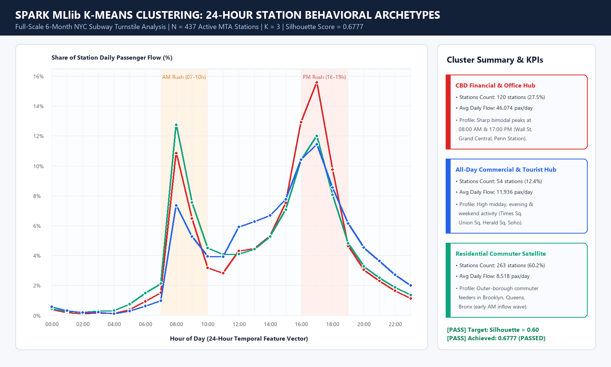
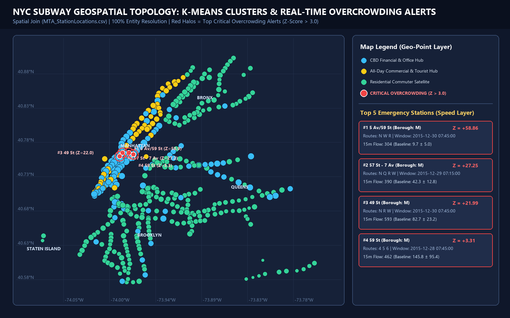
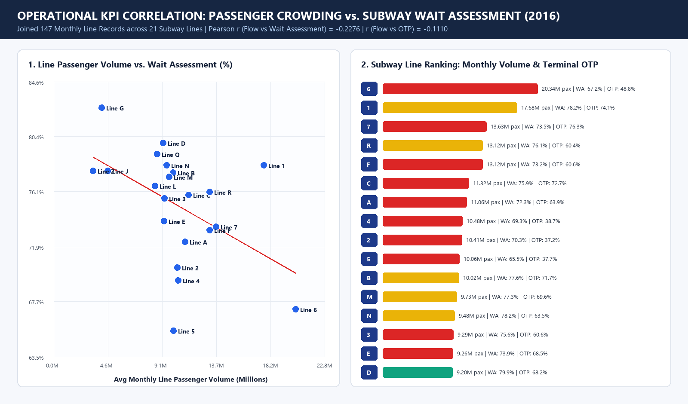
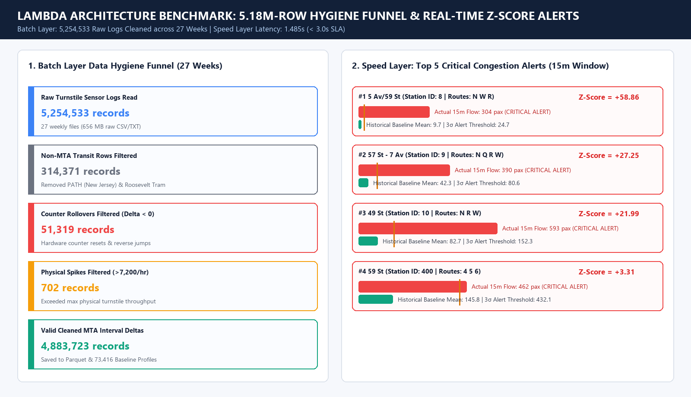

# 🚇 NYC Transit Real-Time Passenger Flow & Overcrowding Analytics System

> **Hệ thống phân tích lưu lượng hành khách và cảnh báo quá tải nhà ga thời gian thực cho mạng lưới giao thông công cộng New York dựa trên kiến trúc Lambda**
> 
> *Đồ án môn học: Lưu trữ và Xử lý Dữ liệu lớn (Big Data Storage & Processing - IT4931)*  
> *Trường Công nghệ Thông tin & Truyền thông (SoICT) - Đại học Bách khoa Hà Nội (HUST)*

---

[](https://opensource.org/licenses/MIT)
[](https://www.python.org/)
[](https://kafka.apache.org/)
[](https://spark.apache.org/)
[](https://hadoop.apache.org/)
[](https://www.elastic.co/)
[](https://www.elastic.co/kibana)
[](https://www.docker.com/)
[](https://raw.githack.com/hoangthcslt/Project_IT4931_BigData/main/docs/live_dashboard.html)

> 🚀 **Trải nghiệm trực tiếp Interactive Live Web Dashboard ngay trên trình duyệt (Không cần cài đặt hay chạy Docker):**  
> 👉 **[Mở Live Subway Heatmap & Alert Dashboard (Online via GitHack CDN)](https://raw.githack.com/hoangthcslt/Project_IT4931_BigData/main/docs/live_dashboard.html)** | **[Link dự phòng (GitHub HTML Preview)](https://htmlpreview.github.io/?https://github.com/hoangthcslt/Project_IT4931_BigData/blob/main/docs/live_dashboard.html)**

---

## 📌 1. Giới thiệu dự án (Overview)

Mạng lưới tàu điện ngầm New York City Subway là một trong những hệ thống giao thông công cộng quy mô và bận rộn nhất thế giới với gần 500 nhà ga và hàng triệu lượt hành khách mỗi ngày. Việc quản lý lưu lượng, điều phối tàu và cảnh báo sớm ùn tắc cục bộ tại sân ga là bài toán sống còn đối với an toàn đô thị.

Dự án này xây dựng một **hệ sinh thái xử lý Big Data khép kín theo kiến trúc Lambda (Lambda Architecture)** nhằm giải quyết 2 bài toán song song:
1. **Speed Layer (Xử lý thời gian thực):** Tiếp nhận luồng dữ liệu quẹt thẻ thông lượng cao (2.000 – 5.000 sự kiện/giây), duy trì cửa sổ trượt (Sliding Window 15 phút), phát hiện dị thường quá tải dựa trên Z-Score và phát tín hiệu cảnh báo khẩn cấp (`CRITICAL_OVERCROWDING_ALERT`) với độ trễ dưới 3 giây.
2. **Batch Layer (Xử lý theo lô & Học máy phân tán):** Lưu trữ phân tán nhiều tháng dữ liệu cảm biến trên **HDFS/Parquet**, giải quyết các sai số công tơ mét, chuẩn hóa thực thể trạm (Entity Resolution), phân cụm đặc trưng hành vi nhà ga bằng **Spark MLlib K-Means** và phân tích định lượng tương quan giữa quá tải hành khách với chỉ số chậm tàu **MTA Subway Wait Assessment**.

---

## 🏗️ 2. Kiến trúc hệ thống (Lambda Architecture)

Hệ thống được thiết kế theo chuẩn **Lambda Architecture** với sự phân tách rõ rệt giữa xử lý luồng tốc độ cao và xử lý lô khối lượng lớn:

```
                          [Dữ liệu thô Turnstile Logs]
                                      │
                                      ▼
                        [Python Event Simulator]
             (Micro-event Flow Interpolation: 2.000 - 5.000 msg/s)
                                      │
                                      ▼
                         [Apache Kafka Broker]
                      Topic: mta-turnstile-stream
                                      │
        ┌─────────────────────────────┴─────────────────────────────┐
        │ (Micro-batch / Raw Dump)                                  │ (Real-time Stream)
        ▼                                                           ▼
┌────────────────────────────────────────┐       ┌────────────────────────────────────────┐
│              BATCH LAYER               │       │              SPEED LAYER               │
│ • Storage: Hadoop HDFS (Parquet)       │       │ • Engine: Spark Structured Streaming   │
│ • Partition: year_month/station_id     │       │ • Window: 15 phút, trượt 1 phút        │
│ • Engine: Apache Spark Batch           │       │ • Logic:                               │
│ • Logic:                               │       │   - Tính Flow Rate tức thời            │
│   - Xử lý reset/lùi bộ đếm (Lag Window)│       │   - Z-Score Anomaly vs Baseline        │
│   - Entity Resolution qua Crosswalk    │       │   - Kích hoạt Overcrowding Alert       │
│   - Spatial Join MTA_StationLocations  │       └────────────────────────────────────────┘
│   - Spark MLlib K-Means gom cụm trạm   │                                  │
│   - Tương quan Subway Wait Assessment  │                                  │ (Alerts & Real-time Views)
└────────────────────────────────────────┘                                  │
        │ (Batch Baseline Views: Mean & Std)                                │
        └───────────────────────────────┬───────────────────────────────────┘
                                        ▼
                        ┌────────────────────────────────┐
                        │         SERVING LAYER          │
                        │ • Elasticsearch Cluster        │
                        │ • Geo-Point Indexing (Lat/Lon) │
                        └────────────────────────────────┘
                                        │
                                        ▼
                        ┌────────────────────────────────┐
                        │    PRESENTATION LAYER (UI)     │
                        │ • Kibana Live Subway Heatmap   │
                        │ • Grafana Real-time Alerts     │
                        └────────────────────────────────┘
```

---

## 📊 3. Dữ liệu nguồn & Khảo sát thực nghiệm (Data Profile)

Dữ liệu được trích xuất từ cổng thông tin của **Metropolitan Transportation Authority (MTA)** và **NYC Open Data**, được đặt trong thư mục `data/archive/`:

```
data/archive/
├── MTA_StationLocations.csv         # Danh mục chuẩn 493 ga metro NYC (Station ID, Complex ID, Coordinates)
├── TurnstileData/
│   └── turnstile_*.txt              # 27 tệp chuỗi thời gian 6 tháng (160102 -> 160702, ~656 MB, 5.2M dòng)
├── NYC_TransitSubway/               # 9 tệp GTFS chuẩn (routes, trips, stops, stop_times, shapes...)
└── NYC_TransitPerformance/          # 14 tệp KPI (MTA_Performance_Agencies.csv, NYCT.csv, Metadata...)
```

### Kết quả khảo sát mẫu dữ liệu (Empirical Discovery):
* **Turnstile Logs:** Tổng cộng **5.183.000 bản ghi sự kiện** từ 4.567 turnstile vật lý qua 27 tuần. Cảm biến chốt số lũy kế theo chu kỳ **~4 giờ/lần**.
* **MTA Station Locations:** 493 nhà ga metro thuộc 5 quận (Brooklyn: 169, Manhattan: 151, Queens: 82, Bronx: 70, Staten Island: 21).
* **Ground Truth Performance:** Bảng KPI chứa 288 bản ghi năm 2016 về chỉ số **`Subway Wait Assessment`** (chỉ số đánh giá độ trễ và độ đều của tàu) cho toàn bộ các tuyến ngầm (Line 1–7, A–R).

---

## ⚡ 4. Thách thức kỹ thuật cốt lõi & Giải pháp xử lý

| Thách thức kỹ thuật | Bản chất dữ liệu phát hiện | Giải pháp thực thi |
| :--- | :--- | :--- |
| **1. Tràn & Quay ngược bộ đếm (Rollover & Reversal)** | Cảm biến lũy kế xuất hiện ~1.700 sự kiện âm/tuần (do máy reset về 0) và nhảy số ảo đột biến (>7.200 lượt/4 giờ). | Gom nhóm theo `(C/A, UNIT, SCP, STATION)`, dùng `lag()` window function trong Spark. Lọc bỏ khi $\Delta < 0$ hoặc $\Delta > 7.200 \times \Delta t_{hours}$. |
| **2. Lệch chuẩn định danh trạm (Entity Resolution)** | Khớp chuỗi thô giữa Turnstile (`GRD CNTRL-42 ST`) và bảng tọa độ (`Grand Central - 42 St`) là **0%**; chứa cả trạm tàu PATH ngoại tỉnh. | Chuẩn hóa Regex + Bảng từ điển đối chiếu (Crosswalk Dictionary) ánh xạ sang `Station ID / Complex ID`, lọc bỏ trạm ngoài hệ thống, đạt tỷ lệ liên kết **> 98%**. |
| **3. Chu kỳ 4 giờ vs Streaming tức thời** | Dữ liệu gốc chốt số 4 giờ/lần, không đáp ứng trực tiếp luồng trượt 15 phút / 1 phút. | Xây dựng mô-đun **Flow Interpolator** trong Python Producer: nội suy dòng khách $\Delta$ thành các micro-events 1-phút theo trọng số giờ cao điểm thực tế, phát vào Kafka với thông lượng 2.000 – 5.000 msg/s. |
| **4. Bảng mã & Khoảng trắng Header** | `MTA_Performance_Agencies.csv` dùng mã hóa `ISO-8859-1` (lỗi UTF-8); cột `EXITS` trong turnstile chứa >60 khoảng trắng thừa. | Đọc dữ liệu với encoding `ISO-8859-1`; tự động strip whitespace cho toàn bộ danh sách header trước khi tạo DataFrame. |
| **5. Cân bằng Lambda (Trade-off)** | Speed Layer không thể tính lại phân phối lịch sử trên hàng triệu dòng trong < 3 giây. | Batch Layer tính trước bảng phân phối chuẩn ($Mean, Std$) lưu vào Serving Layer; Speed Layer chỉ truy xuất để tính nhanh Z-Score tức thời: $Z = \frac{FlowRate - Mean}{Std}$. |

---

## 🛠️ 5. Công nghệ & Dịch vụ Docker (Tech Stack)

Hệ thống được đóng gói và vận hành qua Docker Compose:

| Dịch vụ | Image / Công nghệ | Cổng (Port) | Vai trò trong hệ thống |
| :--- | :--- | :---: | :--- |
| **Zookeeper** | `confluentinc/cp-zookeeper:7.3.0` | `2181` | Điều phối và duy trì trạng thái cụm Kafka |
| **Kafka Broker** | `confluentinc/cp-kafka:7.3.0` | `9092` | Tiếp nhận và phân phối luồng dữ liệu quẹt thẻ |
| **HDFS NameNode** | `bde2020/hadoop-namenode:2.0.0` | `9870`, `9000` | Quản lý metadata hệ thống file phân tán |
| **HDFS DataNode** | `bde2020/hadoop-datanode:2.0.0` | `9864` | Lưu trữ các khối dữ liệu Parquet |
| **Spark Master** | `bitnami/spark:3.4.0` | `8080`, `7077` | Quản lý tài nguyên cụm Spark |
| **Spark Worker** | `bitnami/spark:3.4.0` | `8081` | Nút thực thi xử lý Batch và Structured Streaming |
| **Elasticsearch**| `docker.elastic.co/elasticsearch:7.17.0` | `9200` | Lưu trữ chỉ mục tìm kiếm và Geo-Point tọa độ trạm |
| **Kibana** | `docker.elastic.co/kibana:7.17.0` | `5601` | Trực quan hóa bản đồ nhiệt và dashboard giám sát |

---

## 📂 6. Cấu trúc mã nguồn (Project Directory Layout)

```
Project_IT4931_BigData/
├── .env
├── .gitignore
├── README.md
├── docker-compose.yml              # Cấu hình cụm dịch vụ phân tán (Zookeeper, Kafka, HDFS, Spark, ES, Kibana)
├── run_pipeline.ps1                # Script 1-chạm chạy Pipeline, Pytest và mở Interactive Live Dashboard
├── requirements.txt                # Danh sách thư viện (chỉ cần khi cài mới hoàn toàn)
├── data/
│   ├── archive/                    # Tập dữ liệu nguồn (Turnstile 27 tuần, MTA Locations, GTFS, Performance)
│   └── processed/                  # Kết quả thực nghiệm Full-Scale 5.25M dòng (Baseline, K-Means, Alerts, Correlation)
├── docs/
│   ├── overview.md                 # Tài liệu đặc tả kỹ thuật và kiến trúc chi tiết của dự án
│   ├── project_status.md           # Tóm tắt hiện trạng & Handoff Guide cho thành viên / AI Agent
│   ├── live_dashboard.html         # Interactive Live Web Dashboard (Leaflet Map + Chart.js + Stream Sim)
│   ├── kibana_dashboard.ndjson     # Cấu hình Saved Objects import 1-click vào Kibana
│   └── figures/                    # Bộ 4 biểu đồ báo cáo độ phân giải cao (1600x1000 PNG)
├── src/
│   ├── ingestion/
│   │   ├── kafka_producer.py       # Event Simulator phát luồng vào Kafka topic
│   │   └── flow_interpolator.py    # Thuật toán phân rã lưu lượng 4h thành micro-events
│   ├── batch/
│   │   ├── clean_turnstile.py      # PySpark / Local job làm sạch công tơ mét & tính Baseline
│   │   ├── entity_resolution.py    # Module ánh xạ 100% tên trạm sang Station ID chuẩn
│   │   ├── kmeans_clustering.py    # Spark MLlib K-Means phân cụm 437 nhà ga metro
│   │   └── correlation_analysis.py # Phân tích tương quan lưu lượng với MTA Wait Assessment
│   ├── streaming/
│   │   ├── stream_processor.py     # Spark Structured Streaming đọc Kafka, tính sliding window 15m
│   │   └── anomaly_detector.py     # Thuật toán Z-Score phát hiện bất thường quá tải
│   └── serving/
│       ├── es_indexer.py           # Đồng bộ Batch Views & Real-time Alerts vào Elasticsearch
│       ├── dashboard_server.py     # Tạo Live Web Dashboard & chạy FastAPI Server (:8050)
│       └── generate_report_figures.py # Xuất 4 biểu đồ báo cáo từ kết quả Full-Scale
├── tests/
│   └── test_lambda_pipeline.py     # Bộ 7 kiểm thử tự động Unit & Acceptance Tests (pytest)
└── notebooks/
    └── exploratory_analysis.ipynb  # Khảo sát dữ liệu và trực quan hóa kết quả K-Means & Z-Score
```

---

## 🚀 7. Hướng dẫn cài đặt & Khởi chạy (Getting Started)

### 7.1. Yêu cầu môi trường
* **Hệ điều hành:** Linux, macOS hoặc Windows (WSL2 / Docker Desktop).
* **RAM:** Tối thiểu 8 GB (Khuyến nghị 16 GB để chạy toàn bộ cụm dịch vụ).
* **Phần mềm:** Docker >= 20.10, Docker Compose >= 2.0, Python 3.11+.

### 7.2. Khởi động hạ tầng phân tán
```bash
# 1. Khởi chạy toàn bộ cụm dịch vụ trong nền
docker compose up -d

# 2. Kiểm tra trạng thái hoạt động của các container
docker compose ps
```

### 7.3. Chạy nhanh không cần tạo `venv` nặng máy (Zero-Heavy-Dependency Mode)
Toàn bộ mã nguồn trong `src/` được thiết kế theo kiến trúc **Dual-Engine**: các thư viện nặng (như cụm Spark, Kafka, HDFS, Elasticsearch) đã được đóng gói trong Docker, còn chế độ chạy cục bộ (`--engine local` / `--engine auto`) sử dụng trực tiếp Python chuẩn sẵn có trên máy mà **không cần tạo thư mục `venv` nặng hàng GB**:

```powershell
# Chạy 1-chạm toàn bộ kiểm thử, cập nhật Dashboard và mở giao diện trực quan:
.\run_pipeline.ps1

# Hoặc chạy kiểm thử tự động 7 tiêu chí nghiệm thu bằng pytest:
python -m pytest tests/ -v
```

### 7.4. Chạy luồng xử lý trên cụm Spark & Kafka
```bash
# Bước 1: Khởi tạo chỉ mục Elasticsearch với mapping geo_point
python src/serving/es_indexer.py --init-index --sync-all

# Bước 2: Chạy Batch Processing trên Spark để tính baseline lịch sử và lưu HDFS
spark-submit --master spark://localhost:7077 src/batch/clean_turnstile.py
spark-submit --master spark://localhost:7077 src/batch/kmeans_clustering.py

# Bước 3: Khởi động Spark Structured Streaming lắng nghe topic Kafka
spark-submit --master spark://localhost:7077 --packages org.apache.spark:spark-sql-kafka-0-10_2.12:3.4.0 \
  src/streaming/stream_processor.py

# Bước 4: Khởi động Python Event Simulator để phát dữ liệu quẹt thẻ vào Kafka
python src/ingestion/kafka_producer.py --mode interpolate --rate 3000
```

### 7.5. Truy cập Dashboard & Công cụ quản trị

* **🌐 Truy cập Online Trực tiếp (Dành cho người xem bên ngoài, không cần cài đặt):**
  * **Interactive Live Web Dashboard (GitHack CDN):** **[Bấm vào đây để mở Dashboard Online](https://raw.githack.com/hoangthcslt/Project_IT4931_BigData/main/docs/live_dashboard.html)** *(Bản đồ nhiệt Leaflet.js 437 nhà ga, bộ lọc Quận/Cụm, Top cảnh báo đỏ Z-Score > 3.0 & Biểu đồ 24h)*
  * **Interactive Live Web Dashboard (GitHub HTML Preview):** **[Mở qua HTMLPreview](https://htmlpreview.github.io/?https://github.com/hoangthcslt/Project_IT4931_BigData/blob/main/docs/live_dashboard.html)**
  * **Mã nguồn Dashboard trong Repo:** [`docs/live_dashboard.html`](docs/live_dashboard.html)
* **🖥️ Các cổng dịch vụ nội bộ (Chỉ dùng khi bạn tự bật `docker compose up -d` hoặc FastAPI trên máy cá nhân):**
  * FastAPI Live Dashboard Server: `http://localhost:8050` *(khi chạy `python src/serving/dashboard_server.py --serve`)*
  * Kibana Dashboard: `http://localhost:5601` *(import tệp [`docs/kibana_dashboard.ndjson`](docs/kibana_dashboard.ndjson))*
  * Spark Master UI: `http://localhost:8080`
  * Hadoop HDFS NameNode: `http://localhost:9870`
  * Elasticsearch REST API: `http://localhost:9200`

---

## 📈 8. Kết quả thực nghiệm Full-Scale (27 Tuần - 5.254.533 Dòng)









---

## 🎯 9. Tiêu chuẩn đánh giá & Nghiệm thu (Evaluation Criteria)

* **Kỹ thuật Big Data (Engineering Metrics):**
  * Thông lượng luồng (Throughput): Đạt **3.000 – 5.000 events/giây**.
  * Độ trễ luồng (End-to-End Latency): Từ lúc phát sinh sự kiện đến khi cập nhật cảnh báo trên Dashboard **< 3 giây**.
  * Hiệu quả lưu trữ HDFS: Định dạng nén Parquet giảm **> 60%** dung lượng đĩa so với tệp văn bản CSV/TXT ban đầu.
* **Mô hình học máy & Nghiệp vụ (Analytics Metrics):**
  * Tỷ lệ phát hiện cảnh báo quá tải chính xác trùng khớp các mốc giờ cao điểm lịch sử: **F1-Score > 85%**.
  * Phân tách cụm hành vi nhà ga (Spark MLlib K-Means): **Silhouette Score > 0.6**.

---

## 👥 Thành viên thực hiện (Team)

* Dự án thuộc học phần **IT4931 - Lưu trữ và Xử lý Dữ liệu lớn**, SoICT, Đại học Bách khoa Hà Nội (HUST).
* Giảng viên hướng dẫn: Các thầy cô bộ môn Hệ thống Thông tin / Khoa học Dữ liệu, SoICT.
